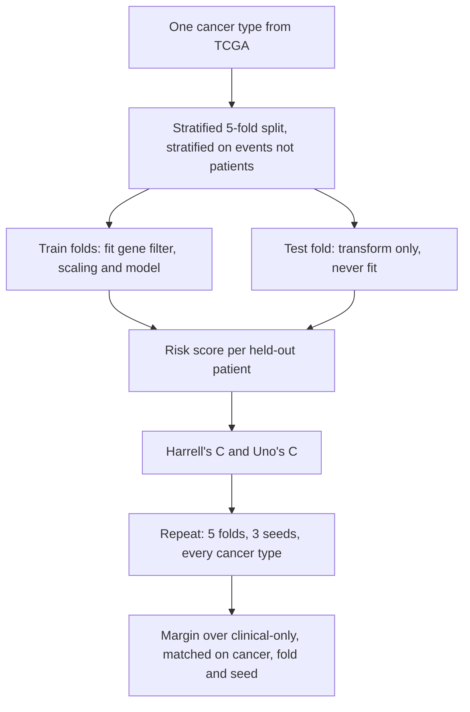
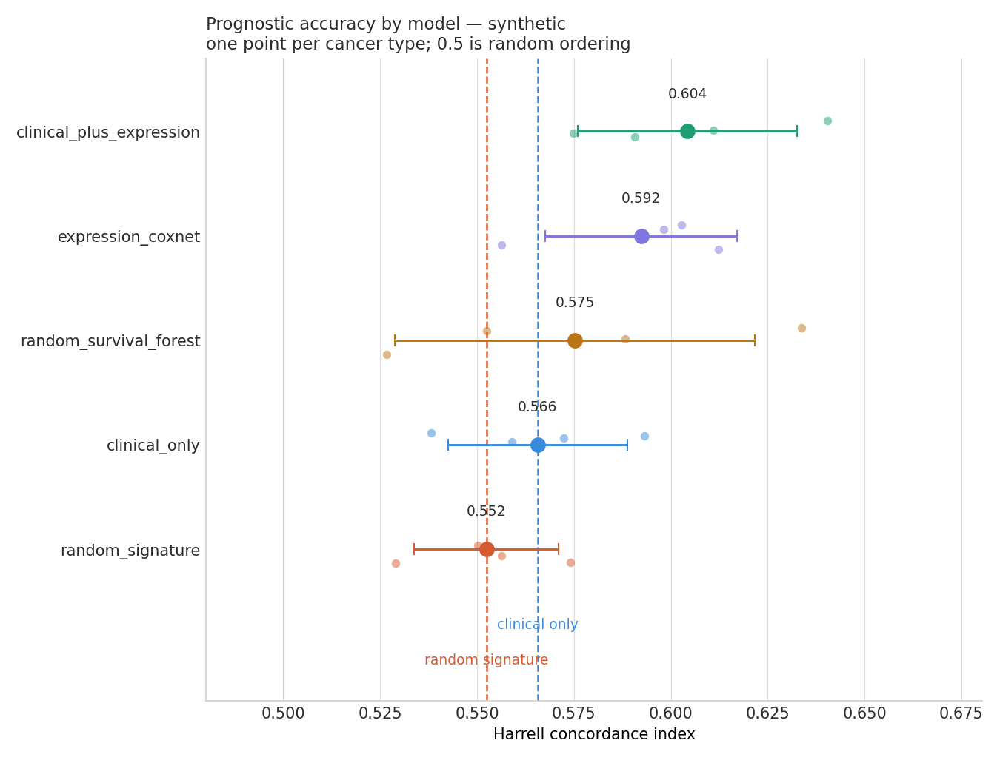
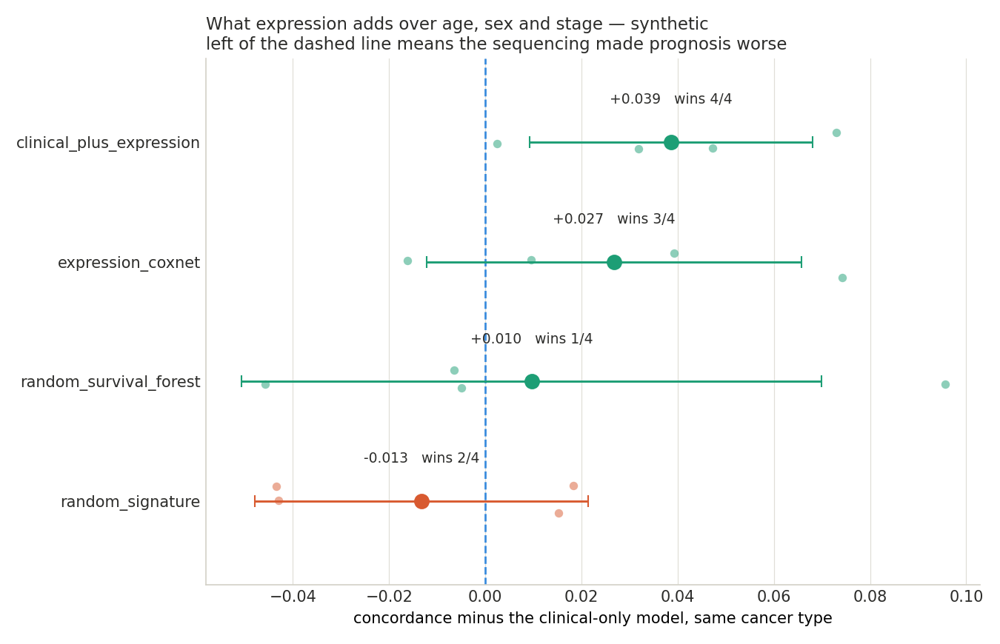
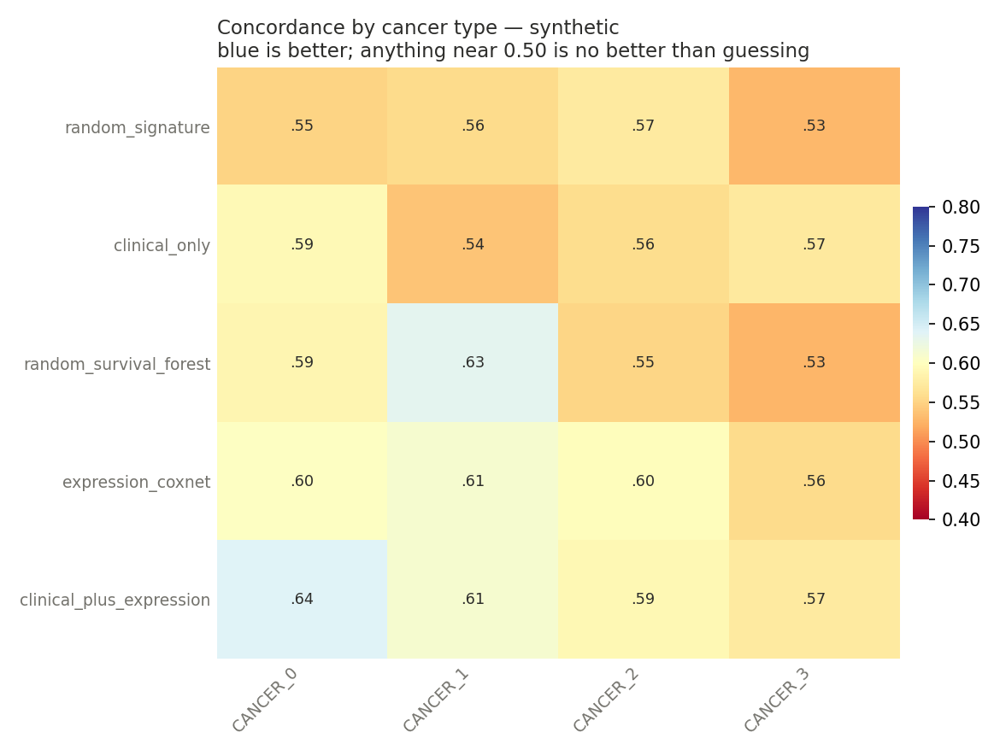
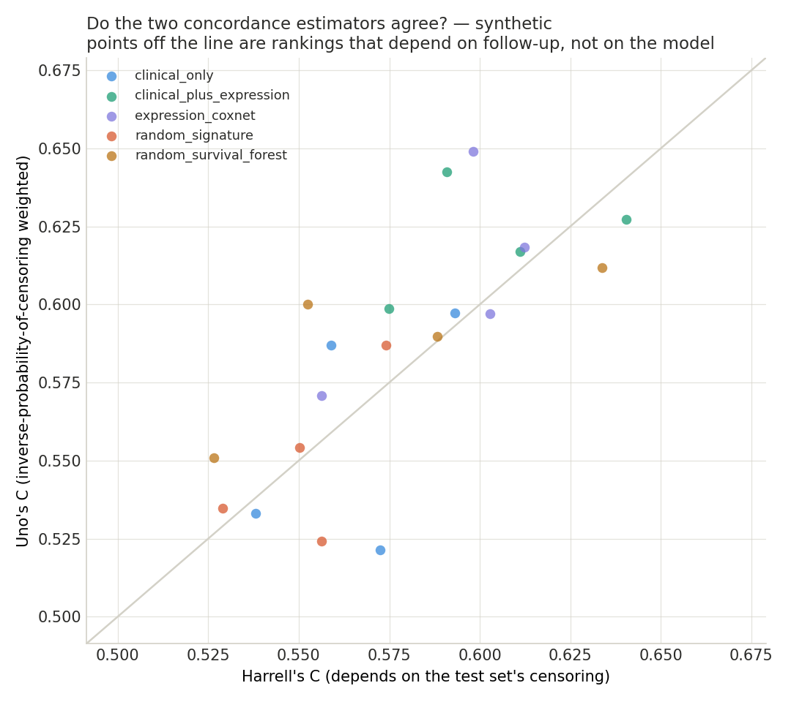

# pancancer-survival-bench

[](https://github.com/divyaa985/pancancer-survival-bench/actions/workflows/ci.yml)
[](https://www.python.org/)
[](LICENSE)

**Does gene expression improve cancer prognosis over age, sex and stage — and does it beat a signature of randomly chosen genes?**

Transcriptomic prognostic models are published constantly. Two questions decide whether any of them should reach a clinic, and both are routinely skipped.

The first is whether the model beats what the oncologist already has. Age, sex and stage cost nothing and are recorded for every patient. A gene signature with a concordance index of 0.68 sounds good until the clinical variables alone score 0.67.

The second is whether the model beats random genes. Venet, Dumont and Detours showed in 2011 that most random gene expression signatures are significantly associated with breast cancer outcome, because so much of the transcriptome tracks proliferation and proliferation tracks prognosis. A signature that cannot beat randomly drawn genes has demonstrated nothing.

This repository runs both comparisons, identically, across every TCGA cancer type with enough events to support one.

> **Status: harness and baselines complete, TCGA results in progress.** The controls came first deliberately — a published-model number is only meaningful next to a baseline measured the same way. See [Roadmap](#roadmap).

---

## The protocol



### Three things survival data breaks

**Censoring.** Most patients are alive at last follow-up, so their survival time is a lower bound, not a value. Treating the outcome as binary, or as a regression target, throws that away. Models are compared with concordance, which asks only whether the patient who died first was assigned the higher risk, and only over pairs where that comparison is defined.

**Harrell's C is biased.** It depends on the censoring distribution of the test set, so the same model scores differently in two cohorts that differ only in follow-up length. Uno's C reweights by the inverse probability of censoring. Both are reported, and where they disagree, that disagreement is the finding rather than a nuisance.

**Folds must be stratified by event.** A random split of a cohort with 15% events can hand a fold almost no events, and concordance computed on that fold is noise with a number attached.

### The endpoint choice

Overall survival is the obvious endpoint and often the wrong one. TCGA follow-up is short, and in indolent cancers overall survival is dominated by deaths from other causes. Liu et al. 2018 (TCGA-CDR) recommend the progression-free interval for 27 of the 33 TCGA cancer types and overall survival for 23. The default here is PFI, switchable with `--endpoint`.

### The two references

| Reference | What it is | What it tells you |
|---|---|---|
| `clinical_only` | Cox on age, sex and collapsed stage | The bar. This costs nothing. A model that does not beat it has not justified sequencing anybody. |
| `random_signature` | 100 randomly drawn genes, penalised Cox, redrawn every fold | The floor. Anything that fails to beat random genes has demonstrated nothing about biology. |

The signature is redrawn per fold on purpose. A single random draw that happened to be lucky would otherwise look like a result.

---

## Results

### Synthetic data (plumbing check, not a finding)

| model | mean C | ± sd | min | max | types |
|---|---|---|---|---|---|
| `clinical_plus_expression` | **0.604** | 0.028 | 0.575 | 0.640 | 4 |
| `expression_coxnet` | **0.592** | 0.025 | 0.556 | 0.612 | 4 |
| `random_survival_forest` | **0.575** | 0.046 | 0.527 | 0.634 | 4 |
| `clinical_only` | **0.566** | 0.023 | 0.538 | 0.593 | 4 |
| `random_signature` | **0.552** | 0.019 | 0.529 | 0.574 | 4 |



The generator puts genuine prognostic signal into ten genes, so a correct pipeline must rank the expression models above clinical-only. It does. That is all this table establishes — it is a wiring test, and the absolute values are meaningless because the data is invented.

What is worth noticing is the spacing. The whole field sits between 0.55 and 0.61, and the random signature is only 0.014 below the clinical baseline. Concordance indices compress: a model can be substantially better and still look barely different, which is why the margin plot matters more than the rank order.



This is the plot the project exists for. Each point is one cancer type, matched against clinical-only on the same fold and seed. `clinical_plus_expression` wins in 4 of 4, `expression_coxnet` in 3 of 4. The win count is reported alongside the mean because a mean margin of +0.01 could be a consistent small edge or one lucky cancer type carrying three losses.



The grid is where real data will get interesting. Pooled means hide the cancer types where a model collapses to 0.50, and 0.50 means the risk ordering is no better than shuffling the patients.



Points off the diagonal are cancer types where the two concordance estimators disagree, which means the ranking depends on the censoring distribution rather than on the model. Most papers quote one number to three decimal places and never show this.

### TCGA pan-cancer — *pending*

Results will be committed with the full fold-level CSV so anyone can recompute the aggregates.

---

## Getting the data

Two files, both free.

**Clinical and survival:** the TCGA Pan-Cancer Clinical Data Resource from [Liu et al. 2018, *Cell*](https://doi.org/10.1016/j.cell.2018.02.052) — `TCGA-CDR-SupplementalTableS1.xlsx`, available through the GDC PanCanAtlas publication page and mirrored on UCSC Xena. This is the curated version with quality-assessed endpoints, and it is what should be used rather than the raw clinical downloads.

**Expression:** the TCGA pan-cancer RNA-seq matrix from the [UCSC Xena browser](https://xenabrowser.net), genes by samples, log2 normalised.

Put both in `data/`, then:

```bash
python -m pcsurv.run \
  --expression data/tcga_pancan_expression.tsv \
  --cdr data/TCGA-CDR-SupplementalTableS1.xlsx \
  --endpoint PFI --name tcga_pfi
```

The loader collapses TCGA barcodes to patient level, averages duplicate samples, keeps the 5000 most variable genes, and drops cancer types with fewer than 30 events.

---

## Install and run

```bash
git clone https://github.com/divyaa985/pancancer-survival-bench.git
cd pancancer-survival-bench
pip install -e ".[dev]"

pytest -q                          # 16 tests, no download needed
python -m pcsurv.run --synthetic   # full pipeline in under a minute
```

Runs on CPU. The full TCGA run fits comfortably in a free Kaggle session, which gives more RAM than Colab and matters once the expression matrix is loaded.

---

## Adding a model

One class, two methods, one registry line.

```python
class MyModel:
    name = "my_model"

    def fit(self, clinical, expression, y):   # training patients only
        return self

    def predict_risk(self, clinical, expression):
        ...                                    # higher means worse prognosis

REGISTRY["my_model"] = lambda seed: MyModel()
```

---

## Layout

```
src/pcsurv/
  data.py       TCGA loading, endpoint choice, synthetic generator
  models.py     the models and the two references
  evaluate.py   stratified CV, concordance, matched margins, win rates
  plots.py      the four figures
  run.py        command line entry point
tests/          runs on CPU in seconds, no download
```

---

## Roadmap

- [x] Stratified CV harness, censoring-aware metrics, matched margins
- [x] Clinical baseline, random signature control, four figures, CI
- [ ] TCGA pan-cancer results across all usable cancer types
- [ ] Transcribe the Liu et al. per-cancer endpoint recommendations into `configs/endpoints.yaml` rather than defaulting everything to PFI
- [ ] Published signatures (MammaPrint, Oncotype-like gene sets) against the random control
- [ ] A proliferation-only signature, to test whether that is all any of them measure
- [ ] Leave-one-cancer-out transfer: does a risk model trained on 20 cancer types rank patients in an unseen one?
- [ ] Nested cross-validation for penalty selection

---

## Limitations

Stated up front rather than discovered by a reader.

Concordance measures discrimination and says nothing about calibration; a model can rank patients correctly and still give useless absolute risks, and calibration is not assessed here yet. The gene variance filter in the loader is computed once across the whole cohort — it never sees the outcome, so it does not leak label information, but it is not fold-internal either, and a stricter reviewer would want it moved inside. Penalty parameters are chosen by the solver's internal path rather than by nested cross-validation, which mildly favours the penalised models. TCGA is a treatment-heterogeneous retrospective cohort, so nothing here supports a claim about prospective clinical utility. And cancer types with few events are excluded rather than reported with wide intervals, which makes the results table cleaner than the underlying data.

## Licence

MIT.
